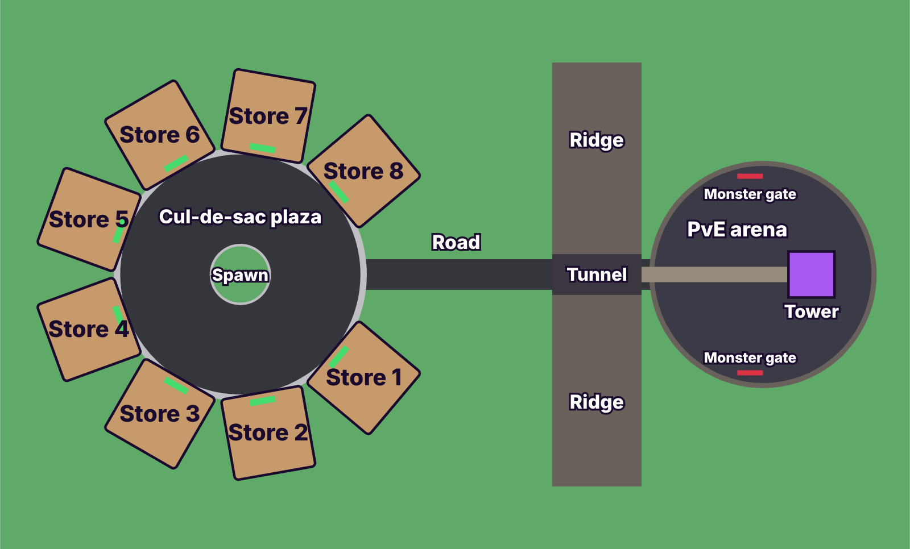
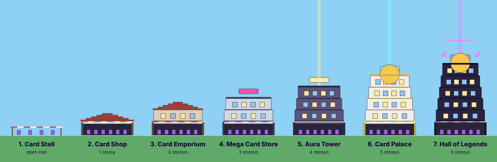

# Aura Packs

A Roblox incremental / tycoon game: open anime card packs, put the cards on display in your store,
collect the cash they earn, buy better packs, upgrade the store, and fill the collection book.
Rare cards also radiate **aura**, a second currency for luck and permanent perks.

## The loop

1. You spawn at your own store plot with one free Starter Pack.
2. Open it (🎴 Packs button, or the Pack Shop counter in your store) — 5 cards per booster.
3. Put cards in your active deck (🃏 Deck & Cards → To deck, or "Auto-fill Deck").
4. The deck earns cash into the register at the front of your store; walk over it to collect.
5. Spend cash on better packs, more deck slots, and store upgrades (income multiplier + new packs).
6. Epic and better cards earn aura every second and a burst of aura when pulled.
7. Three copies of the same card fuse into its next variant (Holo → Gold → Prismatic), and your
   store keeps earning a share of its income for up to 4 hours while you are offline.
8. **Rebirth:** once you have enough cash and aura *and* own the specific cards a rebirth asks
   for, you can reset your run (cash, aura, cards, stands, luck, store) for permanent bonuses:
   +50% income, +10% luck and one more vault slot each time. Cards you put in the **vault**
   beforehand survive the reset, so you start the next run with them.
9. Quality of life: open 3 or 10 packs at once, buy the Auto Collector (aura) so you never walk
   over pads again, and earn +1% income for every card you discover in the collection book.
10. **Sets and booster packs, like a real card game.** Seven numbered sets built from
    public-domain stories and ancient history, 37 cards each (259 cards):
    **Storybook Friends** (Winnie-the-Pooh, Alice, Oz, Peter Pan), **High Seas** (Treasure Island,
    Moby-Dick, Captain Nemo, Sinbad), **Journey to the West** (Sun Wukong and company),
    **Midnight Classics** (Dracula, Frankenstein, Sherlock Holmes), **Olympus** (Greek myth),
    **Knights and Outlaws** (King Arthur, Robin Hood) and **Glory of Rome** (Caesar, Cleopatra,
    Spartacus). Each unlocks at a higher store tier (there
    are seven). Every set has its own colour and emblem, a 5-card **Booster** (3 commons, 1
    uncommon, 1 guaranteed rare-or-better) and a pricier **Elite** pack. Later sets cost more and
    earn more. The **Champion Pack**, which pulls Epic-or-better cards from every set, costs
    500,000 aura and needs the top store tier. The collection book is a binder page per set with card numbers (secret cards are
    numbered past the set size), plus a **combo book** of every story combo. Completing a set
    gives +25% income.
11. **Daily quests and a daily reward:** three quests a day (open packs, pull rares, sell, fuse,
    earn cash) pay aura, and a login streak reward grows up to day 7.
12. **Active deck and combos.** Your deck is the set of cards that earn. It starts with 4 slots
    and grows to 64. Cash piles up at the cash register in your store. Combos add bonuses on top:
    several cards of one type (Warrior, Beast, Mystic, Tech, Star), several from one set, several
    with the same effect, and **story combos** such as Pooh + Piglet + Eeyore + Tigger or Holmes +
    Watson + Mrs. Hudson + Lestrade. Combos pay in cash, aura or luck.
    **Card effects:** a pulled card can be Shiny (x2), Slimy (x1.5, +2% deck cash), Lucky (x1.5,
    +0.5 luck), Shadow (x3, +2 aura/s), Golden (x5) or Prismatic (x20, deck cash and luck).
    **Luck** is a stat with many sources: Lucky Charms (cash), Aura Luck (aura), the Fortune perk,
    rebirths, completed sets, tower floors, deck combos and lucky events. Each level makes better
    rarities 10% more likely.
13. **Battle Tower:** turn-based card duels up a 50-floor tower for aura and cash, with a boss
    every tenth floor. You build a 20-card battle deck from cards you own (they are not used
    up). Each round you gain 1 energy and play one card from a hand of five: strikes, blasts,
    heals, shields, power-ups and weakens. Rarer cards cost more energy. Each type deals +30%
    damage to the next one in the cycle. Duels are staged on your duel pad in the arena: the
    enemies stand as giant shadow cards, themed on the sets, and some heal, wear armour or go
    berserk. Beating a boss for the first time drops a Legendary card. A daily challenge gives
    everyone the same preset deck for aura and a free booster. `node tools/duel-sim.js` shows
    how far different collections get.
    **Titles** (set completions, Golden sets, tower bosses, rebirths, collection size) pay aura
    once and can be worn over your head; pick one in the Quests screen. Three **all-server
    leaderboards** in the plaza show the most rebirths, highest tower floor and biggest
    collection.
14. **Aura Shrine:** permanent perks bought with aura that survive rebirth (starting cash, cheaper
    packs, more aura, better offline earnings, extra vault slots).
15. **Lucky events:** every 20 minutes the whole server gets better pack odds for 5 minutes.
16. **Trading and the market:** trade cards with another player (both sides offer cards and both
    confirm), or list a card for a cash price so anyone in the server can buy it. There is no
    stealing and no PvP.

## Pacing: what makes a run last

- **Wallet cap.** You can hold at most twice the cash your next rebirth costs. When the wallet is
  full the register stops filling, which is the signal to rebirth. Every rebirth raises the cap,
  and the higher store tiers and sets only fit under the later caps.
- **Luck fades in later sets.** A set uses only part of your luck: 100% for the first set, then
  80%, 65%, 50%, 40% and 30%, so rare cards from late sets stay hard to get. Every card slot in
  every pack also keeps at least a 1% chance of a Common, however lucky you are.
- **Rising pack prices.** Each cash pack costs 1.8% more than the last one of its kind opened in
  the same run. Rebirth resets the prices.
- **Auto Packer.** A permanent Aura Shrine perk that buys and opens the pack you choose every 10
  seconds (down to 2 with upgrades), with an option to auto-sell spare low-rarity cards. It plays a sound and shows a banner when it
  pulls a new personal best.
- **Aura Shrine levels unlock with rebirths.** Level 1 of every permanent perk is open from the
  start; each rebirth opens one more level. Aura also arrives more slowly than before.
- **Deck screen tools.** Sort by income, rarity, set, name, effect or copies, and filter to one set.
  Cards in the deck can be fused where they stand (copies in the deck and inventory both count).
  "Pick a combo" opens the combo book, where "Add to deck" puts a whole story combo in for you,
  filling empty slots first and then swapping out your weakest cards.
- **Card detail.** Tap any card in the collection book to see every effect version of it, how
  many you own and where they are (deck, vault).
- **Storefront choice.** From that card detail screen, pick which cards hang in the two frames
  at the front of your store, or leave it on automatic (your deck's top two earners).
- **Codes.** Players type a code on the Store screen for free boosters, aura or cash, once each.
  Codes live in `Config.Codes`; three are set up to start with (RELEASE, AURAPACKS, THANKYOU).
- **Owner reset.** The game's creator sees a "Reset my save" button at the bottom of the Store
  screen, for re-testing the game from the start.
- **Achievements.** 38 long-term goals (packs opened, cards discovered, sets completed, rebirths,
  tower floors, fusions, total cash earned, deck size). Each one claimed gives +3% income forever
  plus aura. They are at the bottom of the Quests screen.
- **Vault.** The safe in the front-left corner of your store, or the top of the Rebirth screen.
  Cards in it survive a rebirth. Any card can be vaulted from the Deck screen, including cards
  that are in the deck.

## Controls

| | Keyboard | Gamepad / console |
| --- | --- | --- |
| Open a screen | The letter shown on its button: **P** Packs, **C** Deck, **B** Book, **U** Upgrades, **T** Trade, **G** Battle, **Q** Quests, **R** Rebirth, **M** Store | **Y** jumps to the menu, **LB / RB** switch screens |
| Close | The same letter again | **B** (or **Y**) |
| Next card when opening a pack | **Space** or **Enter** | **A** |
| Use a counter, safe or gate in the world | **E** | **X** |

## More systems

- **Pack opening.** The pack wobbles harder the better its best card is, then bursts open with a
  flash; big pulls shake the screen, and Mythic or Secret pulls are announced to the whole server.
- **Free boosters.** Every 15 minutes of play earns a free booster of any unlocked set (up to 3
  waiting). Each week one set is **featured** and its packs get +50% luck.
- **Opening several packs.** Anyone can open 1, 2 or 3 packs at once. Opening 10 at once is the
  "10x Pack Opening" game pass.
- **Notifications.** At most five messages show at once; older ones make room for new ones.
- **Full Art.** A rare effect (x8 cash) where the picture fills the card.
- **Showcase.** Two big frames at each store entrance show the owner's two best deck cards.
- **Store.** Things players can buy with Robux. See "Selling things for Robux" below.

## The map



Eight stores sit in a ring around a cul-de-sac plaza (one per player, eight players per server).
One road leaves the plaza and runs through a tunnel in a rocky ridge to the PvE arena, where the
Battle Tower stands. A fountain sits on the plaza island and four small shops line the road
(scenery only).



Each store is a real building that grows as you upgrade it: a market stall with a striped
canopy, then a one-storey card shop with a shopfront, awning and pitched roof, and after that one
more storey per upgrade, up to six, with a neon rooftop sign, the aura beam, a golden dome and
finally floating crystals and a halo. The deck always stands on the ground floor; the upper
storeys are for show. The whole map is built by `src/server/Plots.luau`; the diagram is drawn from
the same numbers by `node tools/make-map.js`.

## Setup

Everything — map, plots, UI — is created by the scripts. There is nothing to build in Studio.

**Easiest — download the built place:** every push builds the game. On GitHub open **Actions**,
pick the latest green **CI** run, download the **AuraPacks** artifact, unzip it and open
`AuraPacks.rbxlx` in Roblox Studio.

**With Rojo:**

```bash
rojo build -o AuraPacks.rbxlx
```

Open `AuraPacks.rbxlx` in Roblox Studio, or run `rojo serve` and connect with the Rojo Studio plugin.

**Without Rojo:** in a new Baseplate place, recreate this layout by hand, pasting each file's contents:

| File | Create as | Where |
| --- | --- | --- |
| `src/shared/*.luau` | ModuleScripts (named like the files) | `ReplicatedStorage/Shared` (a Folder) |
| `src/server/init.server.luau` | Script named `Server` | `ServerScriptService` |
| `src/server/PlayerData.luau`, `Plots.luau` | ModuleScripts | inside the `Server` script |
| `src/client/init.client.luau` | LocalScript named `Client` | `StarterPlayer/StarterPlayerScripts` |

**Then in Studio:**

- Game Settings → Security → turn on **Enable Studio Access to API Services** so saving works in
  Studio (without it the game still runs, progress just is not saved).
- Set the experience's max players to **8** (one plot each; `PlotCount` in `Config.luau`).

## Tuning

| File | What it controls |
| --- | --- |
| `src/shared/Config.luau` | Slots, pack size, sell price, market and trade limits, events, sounds |
| `src/shared/Cards.luau` | Sets and their card lists, rarities, variants, sell prices, aura rates |
| `src/shared/Packs.luau` | Pack slots and odds, which store tier unlocks each set |
| `src/shared/Upgrades.luau` | Store tiers, stand prices, luck prices |
| `src/shared/Perks.luau` | Aura Shrine perks: prices, levels, effects |
| `src/shared/Combos.luau` | Deck combos: type, set, effect and story combos and their bonuses |
| `src/shared/Luck.luau` | Every source of the Luck stat |
| `src/shared/Deck.luau` | How "Auto-fill Deck" chooses cards |
| `src/shared/Season.luau` | The weekly featured set |
| `src/shared/Achievements.luau` | Achievement goals and their permanent bonus |
| `src/shared/Battle.luau` | Tower height and floor rewards |
| `src/shared/Duel.luau` | Turn-based duel rules: card roles, energy, hand, enemies per floor |
| `src/shared/Quests.luau` | Quest types, goals and rewards, daily reward size |
| `src/shared/Rebirth.luau` | Rebirth requirements (cash, aura, cards), bonuses, vault size |

Cards show an emoji as placeholder art. To use real art, upload an image and add
`image = "rbxassetid://123456"` to that card's row in `Cards.luau`.

## Working on the game

`CLAUDE.md` has the project rules and `docs/AGENT_PLAN.md` is the task backlog.

## Selling things for Robux

The Store screen (💎, or **M**) lists everything below. Nothing can be bought until you create the
item on Roblox and paste its id into the game; until then it shows "Coming soon".

| Game pass (bought once) | What it does | Suggested price |
| --- | --- | --- |
| 2x Cash | Double cash from the deck, forever | 399 R$ |
| 2x Aura | Double aura from cards, forever | 299 R$ |
| Auto Collector | Cash goes straight to your balance, survives rebirth | 149 R$ |
| +8 Deck Slots | Eight extra deck slots every run | 249 R$ |
| Bigger Vault | Two extra vault slots | 199 R$ |
| Lucky Clover | +5 luck, forever | 349 R$ |
| 10x Pack Opening | Open 10 packs at once | 199 R$ |
| VIP | Crown on the store sign and +2 luck | 99 R$ |

| Product (bought any number of times) | What it does | Suggested price |
| --- | --- | --- |
| Luck Potion | +10 luck for 30 minutes | 49 R$ |
| Cash Potion | Double cash for 30 minutes | 49 R$ |
| Time Warp | One hour of your deck's income at once (up to the wallet cap) | 79 R$ |
| Aura Bundle / Chest / Vault | 5,000 / 50,000 / 500,000 aura | 49 / 199 / 799 R$ |

To switch them on:

1. Publish the game, then open it on the Creator Dashboard (create.roblox.com).
2. Under **Monetization → Passes**, create each pass, set its price and put it on sale. Under
   **Monetization → Developer Products**, create each product.
3. Copy each item's id (the number in its page address) into `src/shared/Config.luau`, replacing
   the `id = 0` on the matching line, then publish the new build.
4. Buy one of each in a private test to check it arrives.

Prices are set on the dashboard; the suggested ones in the tables are only a starting point. Time
Warp and the aura bundles are hidden from players in places where paid random items are
restricted, because the cash and aura they give can buy packs.

## Balance simulator

```bash
cd tools && npm install && node simulate.js 8
```

Plays a simple player through the real game tables for the given number of hours, across
several rebirths, and prints when each store tier and each rebirth is reached. The simulated
player spends half its income on packs, saves the rest, chases the cards the next rebirth needs
and keeps its best cards in the vault. It does not model aura, luck upgrades or combos chosen by
hand, and it plays faster than a person, so treat the times as a lower bound. Re-run it after
changing prices.

Last run (after the price ladder was retuned):

| Rebirth | Time in that run |
| --- | --- |
| 1 | 1h 14m |
| 2 | 1h 29m |
| 3 | 2h 05m |

## Art

`assets/` holds a game icon, a thumbnail and a cover for every pack, generated by
`tools/make-art.js`. See `assets/README.md` for how to upload them and wire them into the game.
